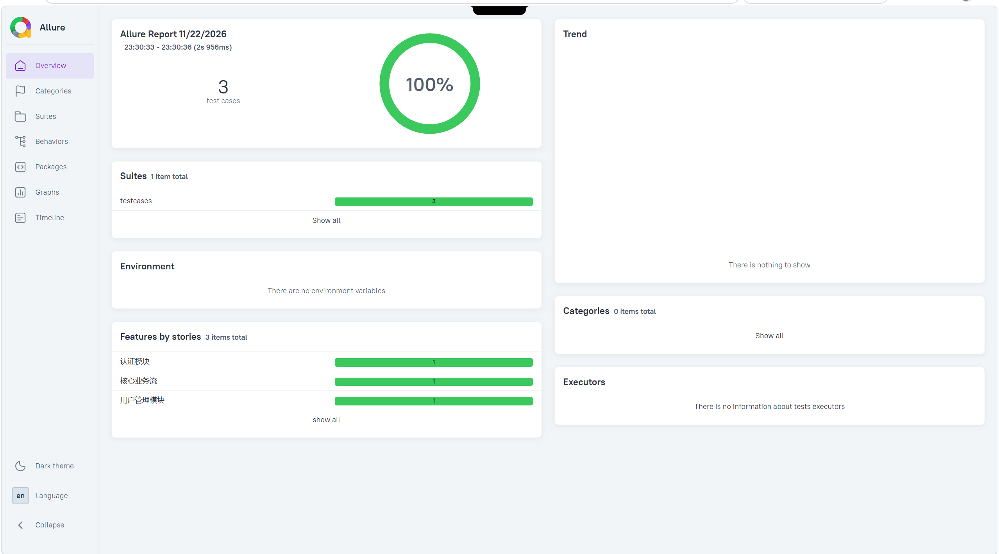
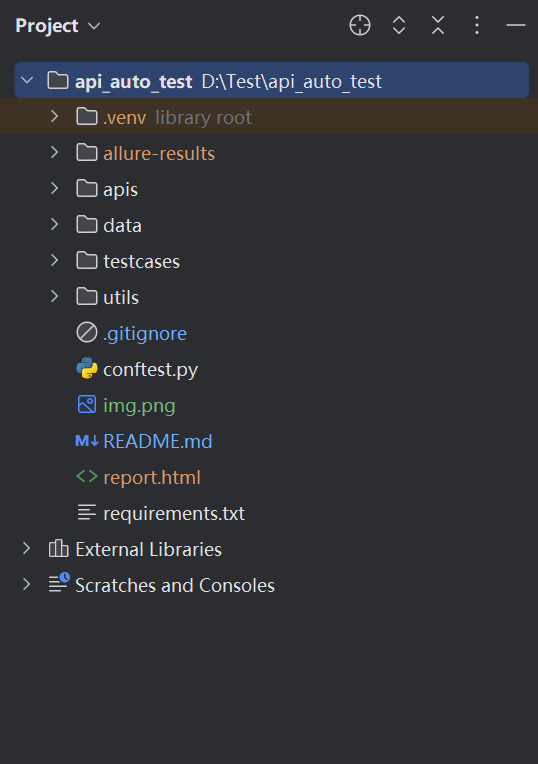

# 接口自动化测试框架（Pytest + Requests + Allure + MySQL）

## 这个项目解决什么问题
针对登录鉴权、购物车增删改查等业务链路，搭建一套可维护的分层接口回归测试框架。
核心目标：新增用例不改框架代码，失败用例能直接定位是“接口挂了”还是“数据没落库”。

## 技术栈与各自角色
- Python：框架语言
- Requests：发送 HTTP 请求、管理 Session
- Pytest：用例组织、Fixture 注入、参数化
- PyYAML：测试数据与代码解耦
- Allure：可视化报告，挂载请求/响应附件
- MySQL：接口执行后的数据库一致性断言
- Git：版本管理，.gitignore 屏蔽敏感配置

## 分层架构
apis/       接口封装层（每个业务接口一个方法）
data/       YAML 测试数据
testcases/  测试用例层
utils/      公共工具（数据库连接、断言助手等）
conftest.py 全局 Fixture：登录 Token 自动注入
pytest.ini  运行配置

## 关键设计（面试官会追问的点，先写清楚）
1. **Token 自动注入**：session 级 fixture 完成登录，其余用例通过 conftest 自动拿到 token，不重复登录。
2. **数据驱动**：用例逻辑写一次，YAML 里加一组数据就多一条用例；新增业务场景不需要动框架代码。
3. **接口 + 数据库双端断言**：不仅看响应码，还查询 MySQL 校验落库数据是否一致，覆盖“接口返回成功但数据没写进去”的盲区。
4. **Allure 附件**：请求体、响应体、断言失败信息挂到报告上，失败用例不需要翻日志就能定位。

## 如何运行
pip install -r requirements.txt
pytest --alluredir=./allure-results
allure serve ./allure-results

## 目录截图 / 报告截图
- Allure 报告截图:
- 目录结构截图: